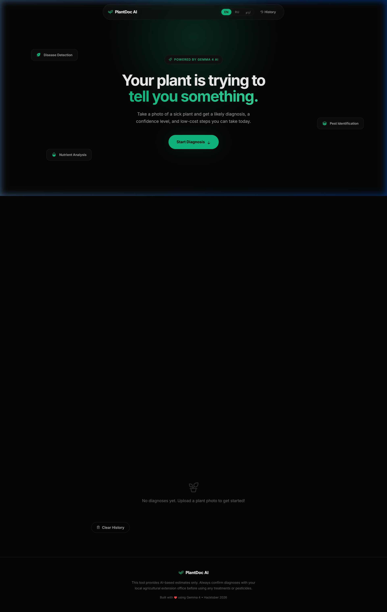

# 🌿 PlantDoc AI

> Snap a photo of your plant. Get a diagnosis, confidence levels, and practical treatment steps — in your own language.

**[🚀 Try the Live App →](https://plantdoc-ai-five.vercel.app/)**




---

## The Pitch

Most AI plant tools are glorified image classifiers: one label, no context, no next steps. **PlantDoc AI is different.** It works like a real plant doctor:

1. **It's honest.** Gives you a ranked differential diagnosis with confidence levels — not a single guess. When it's unsure, it says so.
2. **It asks follow-up questions.** A photo can't show watering habits or soil pH. PlantDoc asks what it needs to know, and lets you refine the diagnosis through conversation.
3. **It gives you actionable treatment steps right now.** Free and low-cost remedies first — remove affected leaves, adjust watering, apply mulch — with urgency labels so you know what to do *today* vs. *this week*.
4. **It speaks your language.** English, Roman Urdu (اردو in English letters), and full Urdu script (اردو) for Pakistani and South Asian farmers who may not have English literacy but do have a smartphone.
5. **Your API key never touches the browser.** Everything is proxied through a secure backend with rate limiting, CSP headers, and CORS — not a client-side demo that leaks your key in DevTools.

Built for Hacktober 2026. Deployed at **[plantdoc-ai-five.vercel.app](https://plantdoc-ai-five.vercel.app/)**.

---

## AI Model

| | |
|---|---|
| **Model** | [Google Gemma 4](https://ai.google.dev/) (`gemma-4-26b-a4b-it`) |
| **API** | Google Gemini API (v1beta `generateContent`) |
| **Why Gemma 4?** | Open-weight, strong vision capabilities, free-tier API access via AI Studio. Unlike larger models, Gemma 4 consistently refuses to output raw JSON for image analysis — so PlantDoc includes a server-side prose parser that extracts structured diagnosis data from the model's natural bullet-point output. This turns out to be *more* reliable than forcing JSON output. |

---

## Features

| Feature | Description |
|---|---|
| 📷 **Image Upload** | Drag & drop, click to upload, or use your phone camera |
| 🔬 **AI Diagnosis** | Identifies plant species + up to 3 health issues with confidence levels |
| 💬 **Follow-up Chat** | Conversational follow-up to refine diagnosis with context |
| 💊 **Treatment Plans** | Actionable steps with cost (free/low/medium) and urgency labels |
| 🌍 **3 Languages** | English, Roman Urdu, Urdu script — switch instantly |
| 📋 **Case History** | Local history of past diagnoses stored in your browser |
| 🛡️ **Security Hardened** | Helmet CSP headers, rate limiting, API key proxying |
| 🖼️ **Test Images** | 5 bundled test images (early blight, aphids, powdery mildew, overwatering, healthy plant) |
| 🤖 **Agent Skill** | Reusable `plant-doctor` Agent Skill following the [Agent Skills](https://agentskills.io) spec |

---

## Tech Stack

- **Frontend**: Vanilla HTML5, CSS3, JavaScript (no framework)
- **Backend**: Node.js + Express 5
- **AI Model**: Google Gemma 4 (`gemma-4-26b-a4b-it`) via Gemini API
- **Security**: Helmet, express-rate-limit, CORS
- **Deployment**: Vercel (serverless functions)
- **Icons**: Phosphor Icons
- **Fonts**: Inter (Google Fonts)

---

## Getting Started

### Prerequisites

- Node.js 18+ installed
- A [Google AI Studio](https://aistudio.google.com/apikey) API key (free tier works)

### Installation

```bash
# Clone the repo
git clone https://github.com/talhasarfraz689/plantdoc-ai.git
cd plantdoc-ai

# Install dependencies
npm install

# Create your environment file
cp .env.example .env
# Edit .env and add your Gemini API key

# Start the server
npm start
```

Then open **http://localhost:3000** in your browser.

### Deploy to Vercel

The project is pre-configured for Vercel deployment:

```bash
# Deploy via CLI
npx vercel

# Add your API key
npx vercel env add GEMINI_API_KEY production

# Deploy to production
npx vercel --prod
```

Or connect via GitHub: import the repo at [vercel.com/new](https://vercel.com/new) and add `GEMINI_API_KEY` in the environment variables section.

### Environment Variables

| Variable | Description | Required |
|---|---|---|
| `GEMINI_API_KEY` | Your Google Gemini API key | Yes |
| `PORT` | Server port (default: 3000) | No |
| `NODE_ENV` | `development` or `production` | No |

---

## Project Structure

```
plantdoc-ai/
├── server.js                # Express backend with API proxying + prose parser
├── api/
│   └── index.js             # Vercel serverless function entry point
├── vercel.json              # Vercel deployment configuration
├── package.json             # Dependencies and scripts
├── .env                     # API key (git-ignored)
├── .gitignore
├── README.md
├── LICENSE
├── .agents/
│   └── skills/
│       └── plant-doctor/    # Agent Skill (see below)
│           ├── SKILL.md
│           └── references/
│               ├── common-issues.md
│               └── diagnosis-schema.md
└── public/
    ├── index.html           # Semantic HTML5 with trilingual support
    ├── styles.css           # Dark emerald design system
    ├── app.js               # Frontend logic, i18n, compression, chat
    ├── screenshot.png       # App screenshot
    └── test-images/         # 5 bundled test images
        ├── early-blight.jpg
        ├── aphids.jpg
        ├── powdery-mildew.jpg
        ├── overwatering.jpg
        └── healthy-plant.jpg
```

---

## 🤖 Agent Skill: `plant-doctor`

PlantDoc AI's diagnosis logic is packaged as a reusable **[Agent Skill](https://agentskills.io)** — a standardized format that lets any compatible AI agent (VS Code Copilot, Claude Code, OpenAI Codex, etc.) use the same plant diagnosis protocol.

### What's in the skill

```
.agents/skills/plant-doctor/
├── SKILL.md                        # Diagnosis protocol, output schema, safety rules
└── references/
    ├── common-issues.md            # Visual signature lookup table (diseases, pests, deficiencies)
    └── diagnosis-schema.md         # JSON Schema for validating diagnosis output
```

### How it works

The skill follows the Agent Skills spec's **progressive disclosure** model:

1. **Discovery** — The agent reads the `name` and `description` from YAML frontmatter (~100 tokens) to decide when to activate.
2. **Activation** — When a user asks about plant health, the agent loads the full `SKILL.md` body containing the 6-step diagnosis protocol, output JSON schema, safety rules, and multilingual support instructions.
3. **On-demand references** — The `references/` directory contains detailed lookup tables and the JSON Schema, loaded only when the agent needs them.

### Spec compliance

The skill follows every requirement from [agentskills.io/specification](https://agentskills.io/specification):

- ✅ `name` field: lowercase, matches directory name, no consecutive hyphens
- ✅ `description` field: describes what and when, includes activation keywords
- ✅ `license` field: MIT
- ✅ `metadata` field: author and version
- ✅ YAML frontmatter + Markdown body format
- ✅ Progressive disclosure: main instructions in SKILL.md, detailed references in separate files
- ✅ File references use relative paths from skill root
- ✅ SKILL.md under 500 lines

### Using the skill

Drop the `plant-doctor/` folder into your agent's skill directory:

| Agent | Skill directory |
|---|---|
| VS Code (Copilot) | `.agents/skills/` |
| Claude Code | `.claude/skills/` or `~/.claude/skills/` |
| Antigravity | `.agents/skills/` or `~/.gemini/config/skills/` |

Then ask your agent: *"What's wrong with this plant?"* + attach a photo.

---

## Architecture

```
┌──────────────┐     POST /api/diagnose     ┌──────────────┐     generateContent     ┌──────────────┐
│              │  ───────────────────────►   │              │  ──────────────────►    │              │
│   Browser    │     { image, language }     │   Express    │     { image + prompt }  │  Gemma 4 AI  │
│   (public/)  │                            │   Server     │                         │  (Gemini API)│
│              │  ◄───────────────────────   │              │  ◄──────────────────    │              │
└──────────────┘     { diagnosis }           └──────────────┘     prose analysis      └──────────────┘
                                                    │
                                           Server-side prose
                                           parser extracts
                                           structured JSON
```

**Key architectural decision**: The API key never reaches the browser. All AI calls are proxied through the Express backend.

---

## Major Challenges & Solutions

### 1. Gemma 4 Refuses to Output JSON

**Problem**: Unlike GPT or Claude, the `gemma-4-26b-a4b-it` model consistently refuses to output raw JSON when analyzing images. It always produces structured bullet-point markdown prose first, regardless of how aggressively the prompt asks for JSON. Setting `responseMimeType: 'application/json'` throws a 500 error (unsupported by this model).

**What we tried**:
- Direct JSON-only system prompts → model ignored them completely
- `responseMimeType: 'application/json'` → 500 Internal Error (unsupported)
- Two-step approach (analyze, then ask model to convert to JSON) → Step 2 returned 500 errors or more prose instead of JSON
- Multi-turn conversation (model "said" the analysis, user asks for JSON) → also 500 errors

**Solution**: Server-side prose parser. Since Gemma's output is *consistently structured* (bullet points, named sections, recognizable patterns), we built a regex-based `parseAnalysisToJson()` function that extracts plant name, issues, confidence levels, treatments, follow-up questions, and limitations directly from the prose. This is actually more reliable than forcing the model to output JSON, because the model's natural analysis format is always well-structured.

### 2. Plant Name Extraction

**Problem**: The model outputs plant names in wildly different formats across requests:
- `"* Plant: Tomato (confirmed by user...)"`
- `"Tomato plant (confirmed by visual...)"`
- `"Tomato (*Solanum lycopersicum*)."`
- `"**Tomato** — identified by leaf shape"`

Early regex attempts captured fragments like "To" (2 chars) or "collapses" (wrong word entirely) due to lazy quantifiers interacting with optional trailing patterns.

**Solution**: A priority-ordered array of 4 regex patterns, each requiring a minimum of 3 lowercase characters after the initial capital, with a blocklist of common false-positive words (`the`, `this`, `confirmed`, `collapses`, etc.). The patterns are tried in order: `Plant: X` → `X plant` → `identified as X` → first capitalized word.

### 3. Treatment Steps Contaminated by Prompt Echoes

**Problem**: Gemma sometimes echoes parts of the system prompt instruction into its analysis output (e.g., "6. What are 2-3 low-cost treatment steps the farmer can do today?"). These leaked into the extracted treatment steps.

**Solution**: Multi-layered filtering:
- Skip lines ending in `?` (questions) or `:` (headings)
- Skip lines starting with analysis-like phrases ("could be", "likely", "diagnosis")
- Skip numbered prompt echoes (`6. What are...`)
- Skip lines containing known prompt phrases ("treatment steps the farmer", "follow-up questions")
- Strip label prefixes ("Sanitation: ", "Watering Management: ") from remaining steps

### 4. API Key Security

**Problem**: Exposing the Gemini API key in frontend JavaScript is a common mistake in demo projects. Anyone could extract it from the browser's DevTools.

**Solution**: All API calls go through the Express backend (`/api/diagnose`, `/api/chat`). The key lives only in `.env` (git-ignored). The backend adds Helmet CSP headers, CORS restrictions, and rate limiting (10 requests/minute per IP).

### 5. Image Size & Compression

**Problem**: Phone camera photos can be 5–15MB, which is too large for the Gemini API and makes requests slow.

**Solution**: Client-side canvas-based compression before upload. Images are resized to max 1024px on the longest side and compressed to JPEG quality 0.7, typically reducing file size to 100–300KB while preserving enough detail for diagnosis.

---

## API Endpoints

### `POST /api/diagnose`
Initial plant diagnosis from an image.

**Request body**:
```json
{
  "image": "base64-encoded-image-data",
  "mimeType": "image/jpeg",
  "context": "Tomato plant, Punjab, summer season",
  "language": "English"
}
```

**Response**:
```json
{
  "diagnosis": {
    "plant": "Tomato",
    "plant_confidence": "high",
    "likely_issues": [
      {
        "name": "Early Blight",
        "confidence": "high",
        "reasoning": "Concentric ring-shaped brown spots with yellowing...",
        "category": "disease"
      }
    ],
    "follow_up_questions": ["Are spots on older or newer leaves?"],
    "treatment_steps": [
      { "step": "Remove affected leaves immediately", "cost": "free", "urgency": "immediate" }
    ],
    "what_i_cant_tell": "Cannot determine root condition from photo",
    "when_to_get_help": "If disease spreads to stem or fruit",
    "is_healthy": false,
    "safety_note": "Consult your local agricultural extension office"
  },
  "rawText": "Original AI analysis in prose form..."
}
```

### `POST /api/chat`
Follow-up conversation with context from the diagnosis.

---

## Language Support

| Language | Code | Example |
|---|---|---|
| English | `EN` | "This tomato plant has Early Blight" |
| Roman Urdu | `RU` | "Is tamatar ke paudhay ko Early Blight hai" |
| Urdu Script | `اردو` | "اس ٹماٹر کے پودے کو ارلی بلائٹ ہے" |

Roman Urdu (Urdu written in English/Latin characters) is widely used by Pakistani farmers who may not have Urdu keyboard input but are more comfortable reading in their native language.

---

## Contributing

1. Fork the repository
2. Create a feature branch (`git checkout -b feature/amazing-feature`)
3. Commit your changes (`git commit -m 'Add amazing feature'`)
4. Push to the branch (`git push origin feature/amazing-feature`)
5. Open a Pull Request

---

## License

This project is open source under the [MIT License](LICENSE).

---

## Acknowledgments

- [Google Gemma 4](https://ai.google.dev/) — open-weight AI model powering the diagnosis
- [Agent Skills](https://agentskills.io) — open standard for reusable AI agent skills
- [Phosphor Icons](https://phosphoricons.com/) — beautiful icon set
- [Inter Font](https://rsms.me/inter/) — clean, readable typeface
- [Vercel](https://vercel.com) — serverless deployment platform
- Built for **Hacktober 2026** 🎃

---

<p align="center">
  <strong>Built with 💚 for farmers and gardeners everywhere</strong><br>
  <em>Because every plant deserves a doctor</em>
</p>
